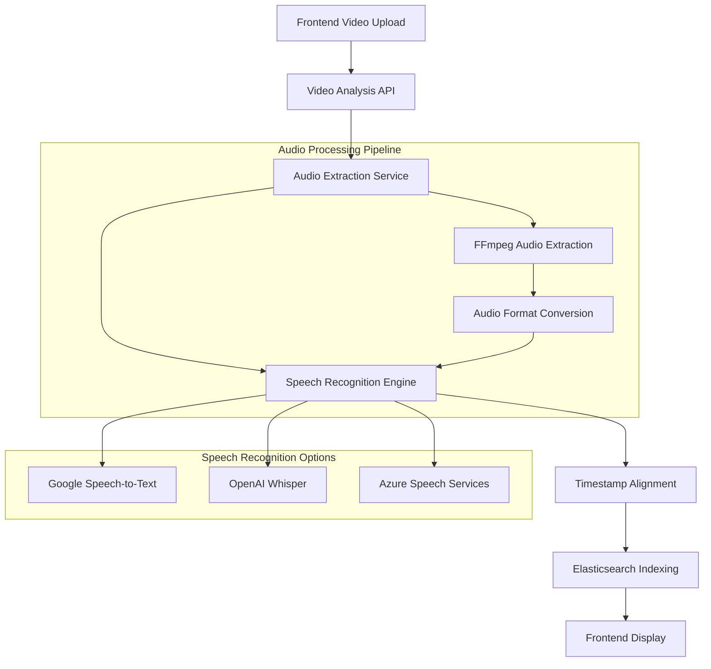

# Audio Transcription Service Design

## Overview

The Audio Transcription Service is a backend component that extracts audio from video files and converts speech to text using advanced speech recognition engines. This service replaces the current visual-based transcript guessing with accurate audio-to-text transcription, providing precise timestamps and high-quality results.

## Architecture

### High-Level Architecture



### Service Integration

The audio transcription service integrates with the existing video analysis pipeline:

1. **Video Upload** → Existing video analysis endpoint
2. **Audio Processing** → New audio transcription service (parallel to visual analysis)
3. **Result Merging** → Combine audio transcripts with visual scene analysis
4. **Storage** → Store in Elasticsearch alongside existing scene data
5. **Frontend** → Display transcripts in existing UI components

## Components and Interfaces

### 1. Audio Extraction Component

**Purpose**: Extract audio tracks from video files using FFmpeg

**Interface**:
```python
class AudioExtractor:
    async def extract_audio(self, video_path: str, output_format: str = "wav") -> str:
        """Extract audio from video file"""
        
    async def get_audio_info(self, video_path: str) -> AudioInfo:
        """Get audio metadata (duration, sample rate, channels)"""
```

**Implementation Details**:
- Use FFmpeg Python bindings for audio extraction
- Support multiple input video formats (MP4, AVI, MOV, WebM)
- Convert to WAV format for optimal speech recognition
- Handle audio normalization and noise reduction

### 2. Speech Recognition Component

**Purpose**: Convert audio to text using cloud-based or local speech recognition

**Interface**:
```python
class SpeechRecognizer:
    async def transcribe_audio(self, audio_path: str, language: str = "en-US") -> TranscriptionResult:
        """Transcribe audio file to text with timestamps"""
        
    async def get_supported_languages(self) -> List[str]:
        """Get list of supported languages"""
```

**Implementation Options**:

#### Option A: Google Speech-to-Text (Recommended)
```python
from google.cloud import speech

class GoogleSpeechRecognizer(SpeechRecognizer):
    def __init__(self):
        self.client = speech.SpeechClient()
        
    async def transcribe_audio(self, audio_path: str, language: str = "en-US") -> TranscriptionResult:
        # Configure recognition with word-level timestamps
        config = speech.RecognitionConfig(
            encoding=speech.RecognitionConfig.AudioEncoding.LINEAR16,
            sample_rate_hertz=16000,
            language_code=language,
            enable_word_time_offsets=True,
            enable_automatic_punctuation=True,
        )
```

#### Option B: OpenAI Whisper
```python
import whisper

class WhisperRecognizer(SpeechRecognizer):
    def __init__(self, model_size: str = "base"):
        self.model = whisper.load_model(model_size)
        
    async def transcribe_audio(self, audio_path: str, language: str = "en") -> TranscriptionResult:
        result = self.model.transcribe(audio_path, language=language, word_timestamps=True)
```

### 3. Timestamp Alignment Component

**Purpose**: Align transcribed text with precise video timestamps

**Interface**:
```python
class TimestampAligner:
    async def align_timestamps(self, transcription: TranscriptionResult, video_duration: float) -> List[TranscriptSegment]:
        """Align speech timestamps with video playback time"""
        
    async def validate_alignment(self, segments: List[TranscriptSegment]) -> bool:
        """Validate timestamp accuracy and consistency"""
```

### 4. Audio Transcription Service

**Purpose**: Main service orchestrating the transcription pipeline

**Interface**:
```python
class AudioTranscriptionService:
    async def transcribe_video(self, video_path: str, video_id: str) -> TranscriptionResult:
        """Complete transcription pipeline for video file"""
        
    async def get_transcription_status(self, job_id: str) -> TranscriptionStatus:
        """Get status of ongoing transcription job"""
```

## Data Models

### TranscriptionResult
```python
@dataclass
class TranscriptionResult:
    job_id: str
    video_id: str
    language: str
    confidence: float
    segments: List[TranscriptSegment]
    processing_time: float
    created_at: datetime
```

### TranscriptSegment
```python
@dataclass
class TranscriptSegment:
    text: str
    start_time_ms: int
    end_time_ms: int
    confidence: float
    speaker_id: Optional[str] = None
    words: List[WordTimestamp] = field(default_factory=list)
```

### WordTimestamp
```python
@dataclass
class WordTimestamp:
    word: str
    start_time_ms: int
    end_time_ms: int
    confidence: float
```

## Error Handling

### Error Types and Responses

1. **Audio Extraction Errors**
   - No audio track in video
   - Corrupted audio data
   - Unsupported audio format

2. **Speech Recognition Errors**
   - API quota exceeded
   - Network connectivity issues
   - Audio quality too poor for recognition

3. **Processing Errors**
   - File size too large
   - Processing timeout
   - Insufficient system resources

### Error Response Format
```python
@dataclass
class TranscriptionError:
    error_code: str
    error_message: str
    error_details: Optional[Dict[str, Any]] = None
    retry_after: Optional[int] = None
```

## Testing Strategy

### Unit Tests
- Audio extraction functionality
- Speech recognition accuracy
- Timestamp alignment precision
- Error handling scenarios

### Integration Tests
- End-to-end transcription pipeline
- API endpoint functionality
- Database storage and retrieval
- Frontend integration

### Performance Tests
- Large file processing (up to 200MB)
- Concurrent request handling
- Memory usage optimization
- Processing time benchmarks

### Test Data Requirements
- Sample videos with clear speech
- Multi-language audio samples
- Videos with background noise
- Edge cases (silent videos, music-only)

## Implementation Phases

### Phase 1: Core Audio Processing
- Implement audio extraction with FFmpeg
- Set up Google Speech-to-Text integration
- Create basic timestamp alignment
- Add error handling and logging

### Phase 2: API Integration
- Create REST API endpoints
- Integrate with existing video analysis pipeline
- Add job status tracking
- Implement result caching

### Phase 3: Advanced Features
- Add multi-language support
- Implement speaker diarization
- Add confidence scoring
- Optimize performance for large files

### Phase 4: Production Readiness
- Add comprehensive monitoring
- Implement rate limiting
- Add security measures
- Performance optimization and scaling