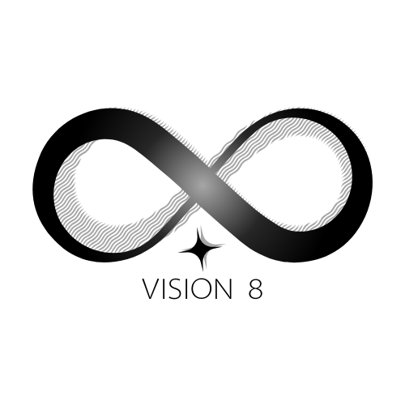

[](/CONTRIBUTING.md)[](#)[](#)[](/LICENSE)

<p align="center">
  
</p>


<p align="center">
  <a href="https://react.dev/" target="_blank"></a>
  <a href="https://www.typescriptlang.org/" target="_blank"></a>
  <a href="https://tailwindcss.com/" target="_blank"></a>
  <a href="https://deepmind.google/technologies/gemini/" target="_blank"></a>
</p>

## Table of Contents

  - [🚀 About Vision 8](#about-vision-8)
    - [🎯 Video-to-Video Generation](#video-to-video-generation)
  - [✨ Key Features](#key-features)
  - [💻 Technology Stack](#technology-stack)
  - [🛠️ Getting Started](#getting-started)
    - [Prerequisites](#prerequisites)
    - [Installation](#installation)
  - [🤝 Contributing](#contributing)
  - [📄 License](#license)


## 🚀 About Vision 8

Vision 8 is a cutting-edge workbench for deep, synchronous video analysis. It leverages Google's Gemini API to deconstruct video content into structured, actionable data: scenes, transcripts, and objects and provides a context-rich, conversational interface for exploration.

### 🎯 Video-to-Video Generation

Vision 8 is engineered as a foundational platform for high-fidelity video-to-video generation. The ultimate aim is to empower users to make minor, targeted changes to a reference video (e.g., swapping an object, changing a sign's text, adjusting lighting) and instantly generate a new, synthesized video of production quality, all while maintaining the original content's integrity and fidelity.

## ✨ Key Features

-   **🤖 AI-Powered Video Analysis**: Utilizes `gemini-2.5-flash` for fast, comprehensive video deconstruction into scenes, transcripts, and tracked objects.
-   **💬 Conversational Intelligence (RAG)**: An integrated chat interface provides intelligent, grounded answers using a Retrieval-Augmented Generation (RAG) pipeline with Gemini Function Calling. All responses are fact-checked and contextually enriched with data retrieved directly from the video's analysis.
-   **🔄 Synchronized Playback**: Clicking any inline citation in the chat automatically navigates the video player to the exact moment referenced, creating a seamless link between conversation, data, and playback.
-   **🖥️ Advanced UI/UX**: Features a fully resizable layout, a dual-player setup for comparison, and frame-accurate playback controls.

## 💻 Technology Stack

| Component | Technology / Role |
| :--- | :--- |
| **Frontend** | React, TypeScript, Tailwind CSS |
| **Video Player** | Custom component built with modern web APIs (Fullscreen, etc.) |
| **AI/LLM** | Google Gemini API (`gemini-2.5-flash`, Function Calling) |
| **Data Retrieval** | RAG pipeline simulated in-app (conceptualized for Elasticsearch) |
| **Deployment** | Designed for serverless environments like Cloud Run |

## 🛠️ Getting Started

This project is a static web application and can be run with any local web server.

### Prerequisites

-   A modern web browser
-   A Google Gemini API Key

### Installation

1.  **Clone the repository:**
    ```bash
    git clone https://github.com/your-repo/vision-8.git
    cd vision-8
    ```

2.  **Set up your Gemini API Key:**
    The application requires a `process.env.API_KEY` to be available in its environment. The application code expects this to be present.

3.  **Serve the application:**
    Use a simple HTTP server to run the `index.html` file. A great option is `serve`.
    ```bash
    npx serve .
    ```
    Now, open your browser to the URL provided by the server (e.g., `http://localhost:3000`).

## 🤝 Contributing

Contributions are what make the open-source community such an amazing place to learn, inspire, and create. Any contributions you make are **greatly appreciated**.

1.  Fork the Project
2.  Create your Feature Branch (`git checkout -b feature/AmazingFeature`)
3.  Commit your Changes (`git commit -m 'Add some AmazingFeature'`)
4.  Push to the Branch (`git push origin feature/AmazingFeature`)
5.  Open a Pull Request

## 📄 License

Distributed under the MIT License. See `LICENSE.txt` for more information. (Note: `LICENSE.txt` file not provided in this project).
